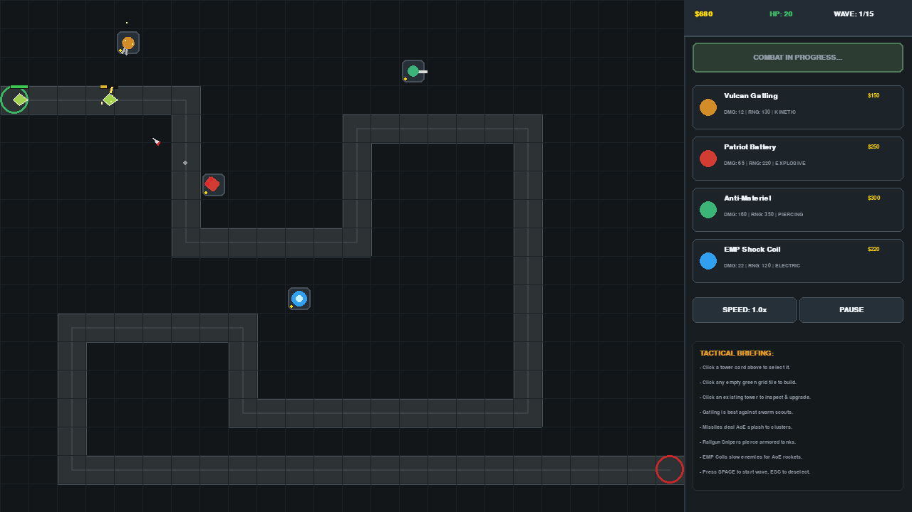

# Modern Military Tower Defence

A tactical modern military-themed Tower Defence game built in Python with **Pygame**.



---

## 🎯 Quick Start for Windows (Easiest Method)

To run the game on **Windows**, you don't need any complex setup:

1. **Double-click `run.bat`**
   - Automatically verifies your Python installation.
   - Automatically initializes an isolated virtual environment (`.venv`).
   - Automatically installs required dependencies (`pygame`).
   - Launches the game immediately!

---

## 🛠 Manual Setup (Windows, macOS, Linux)

If you prefer using the command line:

```bash
# 1. Clone repository
git clone https://github.com/Streamxyz/Game-tower-defence.git
cd Game-tower-defence

# 2. Create and activate a virtual environment
python -m venv .venv
# On Windows:
.venv\Scripts\activate
# On Linux / macOS:
source .venv/bin/activate

# 3. Install requirements
pip install -r requirements.txt

# 4. Run the game
python main.py
```

---

## 📦 Packaging as a Standalone Windows Executable (.exe)

Want to share the game with friends who don't have Python installed?
Simply double-click **`build_exe.bat`** or run:

```bash
pip install pyinstaller
pyinstaller --noconfirm --onedir --windowed --name "ModernMilitaryTowerDefence" main.py
```
The standalone executable will be generated in `dist/ModernMilitaryTowerDefence/`.

---

## 🎮 How to Play & Controls

| Action | Control |
|---|---|
| **Select Tower from Arsenal** | Left-click on shop card in sidebar or press **1, 2, 3, 4** |
| **Place Tower** | Left-click on any empty grid tile (green preview = valid) |
| **Inspect / Upgrade / Sell** | Left-click on any placed tower |
| **Cancel Selection** | Right-click anywhere or press **ESC** |
| **Deploy Next Wave** | Click "DEPLOY NEXT WAVE" button or press **SPACE** |
| **Game Speed (1x / 2x / 3x)** | Click Speed toggle in sidebar |
| **Pause / Resume** | Click Pause button or press **P** |

---

## 🛡️ Arsenal (Defense Towers)

1. **Vulcan Gatling ($150)**: High fire-rate rotary cannon. Shreds fast scouts and light armored vehicles.
2. **Patriot Battery ($250)**: Guided rockets with Area-of-Effect explosive splash damage against clusters.
3. **Anti-Materiel Sniper ($300)**: Long-range armor-piercing kinetic railgun. Ideal for elite tanks and dreadnoughts.
4. **EMP Shock Coil ($220)**: Electrical pulse that damages and slows vehicle movement speed by 55%.

---

## 🎖️ Enemy Ranks

- **Scout Drone / Recon Bike**: Extremely fast, low armor. Bypasses slow defenses.
- **Armed Technical**: Fast skirmish vehicle with infantry support.
- **Armored APC**: High-durability armored troop transport.
- **Main Battle Tank**: Heavy siege vehicle with reinforced armor.
- **Mobile Dreadnought**: Boss-tier siege fortress with massive HP pool.

---

## 📂 Project Architecture

```
Game-tower-defence/
│
├── run.bat                 # 1-Click Windows execution launcher
├── build_exe.bat           # 1-Click Windows PyInstaller packager
├── requirements.txt        # Python dependencies
├── main.py                 # Application entry point
├── PROJECT_PLAN.md         # Comprehensive game design & specs
├── README.md               # User & setup guide
│
├── assets/                 # Game assets
│   ├── sounds/             # Audio buffers
│   └── images/             # Visual previews
│
└── src/                    # Modular engine source code
    ├── config.py           # Resolution, colors, balance values
    ├── sound.py            # Real-time procedural audio synthesis
    ├── map_grid.py         # Battlefield tile grid, waypoints & paths
    ├── enemy.py            # Enemy base class, movement & health logic
    ├── tower.py            # Turret weapons, rotation & targeting AI
    ├── projectile.py       # Ballistics, rockets, laser beams & particles
    ├── wave_manager.py     # Wave progression & spawn scheduling
    ├── ui.py               # HUD, shop panel, upgrade/sell inspector
    └── game.py             # Main game loop & state controller
```
